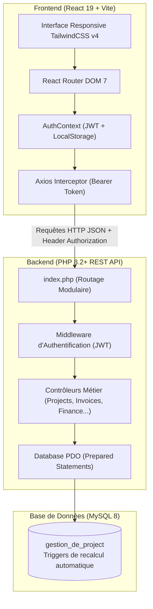

<div align="center">

# 💎 Kalyo (كاليو)
### Plateforme SaaS Marocaine de Gestion de Projets, Trésorerie & Portail Client
#### 🏢 Projet de Fin d'Études (PFE) — Stage au sein de **MORITSOFT**

👨‍💻 **Lead Développeur & Concepteur : [Abdelbasste Errifi (@ERRIFI-X)](https://github.com/ERRIFI-X)** 🇲🇦  
🎨 **Développeur Frontend : [Imad Bouafouss (@2IB2)](https://github.com/2IB2)**  
🧪 **QA, Tests & Validation : [Omar Ouka (@oukaomar8-max)](https://github.com/oukaomar8-max)**

[](https://moritsoft.com)
[](https://github.com/ERRIFI-X)
[-06b6d4?style=for-the-badge&logo=github&logoColor=white)](https://github.com/2IB2)
[](https://github.com/oukaomar8-max)
[](https://www.php.net/)
[](https://react.dev/)
[](https://vitejs.dev/)
[](https://tailwindcss.com/)
[](https://www.mysql.com/)
[](https://jwt.io/)
[](LICENSE)

**Solution d'entreprise marocaine conçue pour digitaliser le cycle de vie des projets, la trésorerie en Dirhams (MAD), et unifier la relation client via des espaces dédiés et étanches.**

[Présentation Interactive](#-présentation-interactive-du-projet-kalyo-launch) •
[Fonctionnalités](#-fonctionnalités-clés) •
[Architecture](#-architecture-technique) •
[Installation](#-guide-dinstallation-rapide) •
[Identifiants Démo](#-comptes-de-test--soutenance-jury) •
[Documentation API](#-documentation-api-rest) •
[Structure](#-structure-du-projet)

---

</div>

## 📌 Présentation du Projet (PFE)

**Kalyo** est né du constat que les TPE, PME et agences de services au Maroc ont besoin d'un outil unifié qui conjugue :
1. **La gestion opérationnelle** : Découpage des projets en jalons et sous-tâches, suivi des livrables et assignation.
2. **Le pilotage financier & trésorerie en MAD** : Suivi des acomptes, créances, factures proforma & définitives avec calcul automatique de la TVA marocaine (20%).
3. **La transparence client** : Un portail dédié et sécurisé où le client final valide les jalons, consulte ses factures certifiées et suit l'avancement en temps réel sans polluer les canaux de messagerie.

---

## 🎬 Présentation Automatique & Interactive (Showcase Autoplay)

<div align="center">

<a href="kalyo-launch.html" target="_blank" title="Cliquez pour ouvrir la version interactive plein écran">
  
</a>

<br />

[](kalyo-launch.html)

> ⚡ **Autoplay en continu** : Le lecteur animé ci-dessus fait défiler automatiquement les 5 scènes clés du projet en boucle continue. Cliquez dessus pour explorer la version interactive complète avec navigation au clavier.

</div>

### 📖 Scénario de la Présentation Interactive :

Cette présentation animée autonome (`kalyo-launch.html`) a été conçue pour introduire la vision du projet, son identité et ses fonctionnalités phares lors de la soutenance :

- **✨ Scène 0 — Identité & Logo 3D Reveal** : Présentation du symbole prismatique en K et de l'identité de marque Kalyo.
- **🔴 Scène 1 — La Problématique des PME** : Analyse des limites de la gestion manuelle (WhatsApp, tableurs Excel non synchronisés, retards de paiement non tracés).
- **🟢 Scène 2 — La Solution Kalyo** : Écosystème centralisé unifiant pilotage opérationnel, trésorerie en Dirhams marocains (MAD) et transparence client.
- **👔 Scène 3 — Espace Direction & Management** : Vue décisionnelle, simulateur de trésorerie en temps réel, calcul automatique de la TVA marocaine (20%) et suivi WBS.
- **🤝 Scène 4 — Portail Partenaire Client** : Interface dédiée aux entreprises clientes pour valider les jalons, consulter leurs factures certifiées et suivre l'état d'avancement.
- **🚀 Scène 5 — Déploiement & Perspectives** : Clôture avec accès direct aux environnements de test et synthèse de l'architecture fullstack.

> 💡 **Comment lancer la présentation ?**  
> Ouvrez simplement le fichier [`kalyo-launch.html`](kalyo-launch.html) dans n'importe quel navigateur Web moderne (Chrome, Edge, Firefox, Safari) ou via l'application Frontend React sur `/kalyo-launch.html`. La navigation se fait à l'aide des flèches du clavier ou des commandes à l'écran.

---

## 🚀 Fonctionnalités Clés

### 👔 1. Espace Direction & Management (`/login/admin`)
- **Tableau de bord décisionnel** : Chiffre d'affaires global, créances en attente, projets en retard, taux de complétion.
- **Simulateur de Trésorerie Dynamique** : Analyse prédictive du cashflow en dirhams marocains (MAD) avec simulation d'encaissements.
- **Gestion des Projets & Packs** : Création de projets au forfait ou récurrents, association de packs de services prêts à l'emploi.
- **Découpage WBS (Tâches & Sous-tâches)** : Statuts en temps réel (`À faire`, `En cours`, `Terminé`, `En retard`), dates limites et pondération.
- **Facturation & Règlements** :
  - Génération de factures conformes aux normes fiscales marocaines (HT, TVA 20%, TTC).
  - Gestion des modes de paiement (Virement bancaire, Chèque, Espèces).
  - Template d'impression et export prêt pour impression / PDF.
- **Gestion CRM Clients** : Fiches complètes des entreprises clientes, contacts référents, total facturé, solde restant dû et export CSV.
- **Centre de Notifications & Audit** : Alertes automatiques en cas de retard de paiement ou de franchissement de jalon.

### 🤝 2. Portail Partenaire Client (`/login/client`)
- **Vue d'ensemble simplifiée** : Visualisation claire et synthétique des projets confiés à l'agence.
- **Suivi des Jalons** : Barres de progression, détails des livrables sans accès aux métriques internes de marge de l'agence.
- **Espace Factures & Reçus** : Téléchargement et consultation de l'historique de facturation et des preuves de paiement.
- **Sécurité et Isolation des Données** : Chaque client n'accède strictement qu'aux données de son entreprise via des contrôles stricts par token JWT.

### ✨ 3. Expérience Utilisateur & Design System
- **Design Haute Fidélité** : Interface développée sur-mesure avec Tailwind CSS v4, dégradés d'accentuation, micro-animations et effets de verre (Glassmorphism).
- **Mode Sombre / Clair** : Basculement fluide avec mémorisation de la préférence dans le `localStorage`.
- **Identité Visuelle Forte** : Logo 3D isométrique prismatique (lettre K) développé en SVG vectoriel.
- **Accès Démo 1-Clic** : Boutons de remplissage instantané pour tester les deux espaces (Admin & Client) sans saisie manuelle.

---

## 🏗 Architecture Technique



---

## 🛠️ Stack Technologique

| Domaine | Technologies | Rôle & Description |
| :--- | :--- | :--- |
| **Frontend** | React 19, Vite 6, TailwindCSS v4 | Interface réactive, compilation ultra-rapide et design moderne. |
| **Routing & State** | React Router DOM 7, Context API | Navigation SPA fluide, gardes d'authentification (`ProtectedRoute`). |
| **HTTP Client** | Axios avec Intercepteurs | Injection automatique du token JWT et gestion centralisée des erreurs 401/403. |
| **Backend API** | PHP 8.2+ Vanilla, Composer | Architecture REST, POO propre, sans surcharge de framework lourd. |
| **Sécurité** | Firebase JWT (`firebase/php-jwt`), Bcrypt | Tokens signés avec expiration, hachage robuste des mots de passe. |
| **Persistance** | MySQL 8.0, PDO | Requêtes préparées anti-injections SQL, triggers financiers automatiques. |
| **UI Components** | Lucide React, React Hot Toast | Icônes modernes, notifications toast interactives. |

---

## ⚙️ Guide d'Installation Rapide

### Prérequis
- **PHP** : version 8.2 ou supérieure (avec extensions `pdo_mysql`, `openssl`, `mbstring`).
- **Composer** : Gestionnaire de dépendances PHP.
- **Node.js** : version 18 ou supérieure & **npm**.
- **MySQL / MariaDB** (via XAMPP, Laragon, Docker ou MySQL Server natif).

---

### 1. Cloner le Projet

```bash
git clone https://github.com/oukaomar8-max/front_gestion_project.git frontend
git clone https://github.com/oukaomar8-max/backend_gestionPro.git backend
# Ou si vous travaillez dans le dossier unifié STAGE PFE :
cd "STAGE PFE"
```

---

### 2. Configuration de la Base de Données

1. Démarrez votre service MySQL.
2. Créez la base de données :
   ```sql
   CREATE DATABASE gestion_de_project CHARACTER SET utf8mb4 COLLATE utf8mb4_unicode_ci;
   ```
3. Importez le fichier SQL [`backend/database.sql`](backend/database.sql) :
   ```bash
   mysql -u root -p gestion_de_project < backend/database.sql
   ```
4. Configurez vos accès dans [`backend/routes/config.php`](backend/routes/config.php) ou via le fichier `.env` :
   ```php
   define('DB_HOST', 'localhost');
   define('DB_USER', 'root');
   define('DB_PASS', '');
   define('DB_NAME', 'gestion_de_project');
   define('JWT_SECRET', 'votre_cle_secrete_ultra_securisee_kalyo_2026');
   ```

---

### 3. Démarrer le Backend PHP

```bash
cd backend
composer install
php -S localhost:8000
```
> Le serveur d'API REST sera actif sur : **`http://localhost:8000`**

---

### 4. Démarrer le Frontend React

Dans un nouveau terminal :

```bash
cd frontend
npm install
npm run dev
```
> L'application Web sera accessible sur : **`http://localhost:5173`**

---

## 🧪 Comptes de Test / Soutenance Jury

Pour faciliter l'évaluation du projet et la démonstration en direct, des comptes de test prêts à l'emploi et des boutons de remplissage rapide en **1-Clic** ont été intégrés :

| Rôle | URL de Connexion | Identifiant / Username | Mot de passe | Description |
| :--- | :--- | :--- | :--- | :--- |
| **Direction (Admin)** | [`http://localhost:5173/login/admin`](http://localhost:5173/login/admin) | `admin_tester` *(ou `admin`)* | `tester123` *(ou `admin123`)* | Accès complet aux projets, finances, créances, factures et paramètres. |
| **Partenaire Client** | [`http://localhost:5173/login/client`](http://localhost:5173/login/client) | `user_tester` | `tester123` | Espace client dédié avec vue restreinte sur ses projets et factures associées. |

---

## 📡 Documentation API REST

Tous les points de terminaison protégés exigent l'en-tête HTTP :  
`Authorization: Bearer <votre_token_jwt>`

### 🔑 Authentification
| Méthode | Endpoint | Accès | Description |
| :--- | :--- | :--- | :--- |
| `POST` | `/api/login` | Public | Authentification Admin & génération du token JWT |
| `POST` | `/api/client/login` | Public | Authentification Partenaire Client |
| `POST` | `/api/register` | Admin | Création d'un nouvel administrateur |

### 📁 Gestion des Projets
| Méthode | Endpoint | Accès | Description |
| :--- | :--- | :--- | :--- |
| `GET` | `/api/projects` | Admin | Liste de tous les projets avec filtres |
| `POST` | `/api/projects` | Admin | Création d'un projet |
| `GET` | `/api/projects/{id}` | Admin/Client | Détails d'un projet et de ses jalons |
| `PUT` | `/api/projects/{id}` | Admin | Mise à jour des informations d'un projet |
| `DELETE` | `/api/projects/{id}` | Admin | Suppression d'un projet |
| `GET` | `/api/client/projects` | Client | Projets assignés au client connecté |

### 👥 Gestion des Clients
| Méthode | Endpoint | Accès | Description |
| :--- | :--- | :--- | :--- |
| `GET` | `/api/clients` | Admin | Liste complète des clients et statistiques |
| `POST` | `/api/clients` | Admin | Ajout d'une nouvelle entreprise cliente |
| `PUT` | `/api/clients/{id}` | Admin | Modification des informations client |
| `DELETE` | `/api/clients/{id}` | Admin | Archivage / Suppression du client |

### 💰 Facturation & Règlements
| Méthode | Endpoint | Accès | Description |
| :--- | :--- | :--- | :--- |
| `GET` | `/api/invoices` | Admin | Liste de toutes les factures émises |
| `POST` | `/api/invoices` | Admin | Création d'une nouvelle facture (HT, TVA 20%, TTC) |
| `GET` | `/api/invoices/{id}` | Admin/Client | Récupération d'une facture pour impression |
| `POST` | `/api/payments` | Admin | Enregistrement d'un règlement reçu |
| `GET` | `/api/payments` | Admin | Historique des paiements avec filtres |
| `GET` | `/api/client/invoices` | Client | Factures du client connecté |

### 📊 Tableau de Bord & Indicateurs
| Méthode | Endpoint | Accès | Description |
| :--- | :--- | :--- | :--- |
| `GET` | `/api/dashboard/stats` | Admin | KPI financiers, volume projets, alertes de retard |
| `GET` | `/api/client/dashboard` | Client | Indicateurs synthétiques pour le portail client |

---

## 📂 Structure du Répertoire

```text
STAGE PFE/
├── README.md                    # Documentation globale et présentation PFE
├── .gitignore                   # Exclusion des fichiers sensibles et dépendances
│
├── backend/                     # API RESTful PHP 8.2+
│   ├── controllers/             # Logique applicative (Auth, Projects, Finance, Invoices...)
│   ├── models/                  # Modèles PDO, schémas, migrations et Factory
│   ├── routes/                  # Routeur modulaire et configuration
│   │   ├── config.php           # Paramètres de base de données et constantes JWT
│   │   └── ...                  # Fichiers de routes spécialisés
│   ├── database.sql             # Schéma SQL complet avec triggers de recalcul
│   ├── composer.json            # Dépendances backend (firebase/php-jwt)
│   ├── .env.example             # Modèle de variables d'environnement
│   ├── index.php                # Front Controller et point d'entrée de l'API
│   └── README.md                # Documentation technique spécifique au Backend
│
└── frontend/                    # Application Single Page React 19 + Vite
    ├── public/                  # Assets publics (favicon, images)
    ├── src/
    │   ├── api/                 # Instance Axios configurée et endpoints
    │   ├── components/          # Composants modulaires (Header, Sidebar, Modals, Forms)
    │   ├── context/             # AuthContext et gestion globale de la session
    │   ├── pages/               # Pages Direction (Dashboard, Projets, Clients, Factures...)
    │   │   └── user/            # Pages du Portail Partenaire Client (UserDashboard...)
    │   ├── Router/              # Configuration des routes React Router 7 et gardes
    │   ├── index.css            # Feuille de style Tailwind CSS v4
    │   ├── App.jsx              # Composant racine
    │   └── main.jsx             # Point de montage DOM
    ├── package.json             # Dépendances Node & scripts de build
    ├── vite.config.js           # Configuration Vite
    ├── .env.example             # Modèle de configuration API pour le front
    └── README.md                # Documentation technique spécifique au Frontend
```

---

## 🔒 Sécurité & Bonnes Pratiques

- **Prévention des Injections SQL** : Utilisation exclusive de requêtes préparées via l'interface **PDO MySQL**.
- **Chiffrement des Mots de Passe** : Algorithme **Bcrypt** (`PASSWORD_BCRYPT`) avec coût de calcul adapté.
- **Tokens JWT Stateless** : Signature cryptographique sécurisée et expiration configurée pour limiter la surface d'attaque.
- **Cloisonnement des Rôles** : Gardes de navigation côté client (`ProtectedRoute`) et vérification du rôle côté serveur dans les contrôleurs.
- **Validation & Assainissement** : Contrôle des types de données et nettoyage des entrées utilisateurs contre les failles XSS.

---

## 👨‍💻 Équipe du Projet & Soutenance

<div align="center">

<table align="center" style="border: none; background: transparent;">
  <tr align="center">
    <td align="center" width="220" style="padding: 14px; border: none;">
      <a href="https://github.com/ERRIFI-X" target="_blank">
        
      </a>
      <br /><br />
      <h3 style="margin: 0; font-size: 16px;"><b>Abdelbasste Errifi</b></h3>
      <p style="margin: 4px 0 10px 0; font-size: 12px; color: #10b981; font-weight: bold;">Lead Développeur Full-Stack & Concepteur</p>
      <a href="https://github.com/ERRIFI-X"></a>
      <a href="mailto:abdelbasset.errifi@gmail.com"></a>
    </td>
    <td align="center" width="220" style="padding: 14px; border: none;">
      <a href="https://github.com/2IB2" target="_blank">
        
      </a>
      <br /><br />
      <h3 style="margin: 0; font-size: 16px;"><b>Imad Bouafouss</b></h3>
      <p style="margin: 4px 0 10px 0; font-size: 12px; color: #06b6d4; font-weight: bold;">Développeur Frontend (React / Tailwind)</p>
      <a href="https://github.com/2IB2"></a>
      <a href="mailto:i.bouafouss@gmail.com"></a>
    </td>
    <td align="center" width="220" style="padding: 14px; border: none;">
      <a href="https://github.com/oukaomar8-max" target="_blank">
        
      </a>
      <br /><br />
      <h3 style="margin: 0; font-size: 16px;"><b>Omar Ouka</b></h3>
      <p style="margin: 4px 0 10px 0; font-size: 12px; color: #6366f1; font-weight: bold;">Assurance Qualité (QA), Tests & Validation</p>
      <a href="https://github.com/oukaomar8-max"></a>
      <a href="mailto:oukaomar8@gmail.com"></a>
    </td>
  </tr>
</table>

🎓 **Projet de Fin d'Études (PFE)** — Réalisé au sein de **MORITSOFT** (2025 / 2026)  
🇲🇦 Conçu et développé avec passion pour la digitalisation des entreprises marocaines.

</div>

---

<div align="center">
  <sub>Fait avec passion pour la digitalisation des entreprises marocaines 🇲🇦. Propulsé par Kalyo.</sub>
</div>
